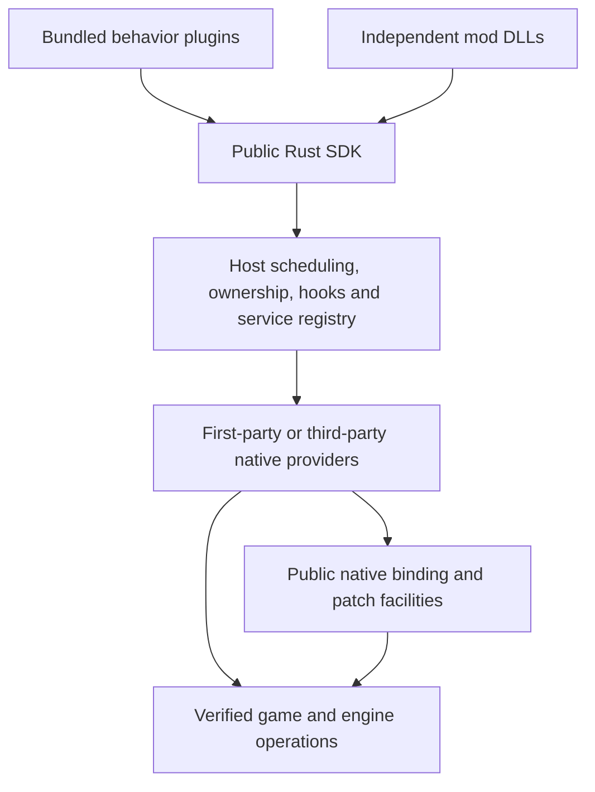

# Rust modding platform specification

Status: proposed architecture and product contract, 2026-10-08. This document
specifies future behavior. It does not announce an implemented SDK or verified
native bindings. The [example interface](plugin-platform-api.md) uses proposed
names that do not currently compile against `rekenshi-plugin-sdk`.

The [implementation record](plugin-platform-implementation.md) tracks the public
operation/lifecycle foundation now implemented, its native integration inventory,
and the migrations and native evidence still outstanding. The specification
below remains the broader target; implementation status is stated separately.

## 1. Objective and scope

Make RE_Kenshi Rust a platform for independently distributed Rust mods that can
observe, extend, and replace game behavior. Common operations should be easy;
unsupported operations should be implementable by plugin authors through public
native extension facilities, without editing or recompiling the host.

Built-in caches, graphics, weather, and UI modifications must use the same public
contracts available to external plugins. Bundling determines distribution and
default activation, not privileged access to game internals.

The platform must not impose an arbitrary list of moddable systems. This does
not promise a safe binding for every internal method, automatic compatibility
between arbitrary binary patches, source recovery, or support for every build.
Native capability coverage grows through verified adapters, including adapters
distributed by third parties. Missing evidence is reported as unsupported.

Content authoring stays with the game's existing mod/content workflow. The baseline
Rust SDK consumes definitions and assets loaded by the game or installed data mods;
it does not add a mesh importer, model editor, or replacement content-authoring
pipeline. Its focus is runtime behavior, creation of instances from existing
definitions, and rendering/shader control. Advanced native extensions remain able
to experiment with additional resource loading without making it a baseline feature.

The [tool decision guide](modding-tool-boundary.md) defines when to use FCS,
existing content/layout tools, Rust, or a combined mod. Prefer existing definitions
and supported declarative rules when they express the change faithfully. FCS
already supports some reactive behavior; a change occurring during play is not
by itself a reason to require a DLL. Rust supplies missing runtime operations,
algorithms, interception and state sources. See the [glossary](../GLOSSARY.md) for
definition, template, instance and provider terminology.

This specification covers the host, public Rust interface, portable DLL
transport, native providers, tools, packaging, persistence, diagnostics, and
verification. It is a focused product design, not a complete workspace guideline
audit. Existing documented deviations and verification limits remain visible.

## 2. Current baseline and missing capabilities

| Area | Repository evidence | Current limit | Proposed addition |
| --- | --- | --- | --- |
| Independent plugins | [`plugin-sdk.md`](plugin-sdk.md), `crates/plugin-sdk/src/dll.rs` | Local source dependency; limited public services | Versioned distributable SDK and development tools |
| Lifecycle/settings | `crates/plugin-runtime/src/lib.rs` | `update` applies settings; no public world lifecycle | Explicit lifecycle, domain events, settings updates, save/load, task completion |
| Managed callbacks | `crates/plugin-runtime/src/host.rs` | Ogre singleton getter and MyGUI frame observers | Domain events and typed interception contracts |
| Gameplay | [`gameplay.md`](gameplay.md), `src/gameplay/` | Copied player roster; move, stop, follow, standing orders; attack unavailable | World/entity queries, gameplay mutation, native operation providers |
| Clock | No clock service in the public SDK | No supported world-time setter | Separate visual time, calendar, and simulation controls |
| Creation | No spawning service in the public SDK | No supported item/NPC/object creation interface | Instances of loaded item/object/character/squad definitions, and persistence |
| Rendering | [`graphics.md`](graphics.md), `crates/plugin-sdk/src/graphics.rs` | Shared LDR post-tonemap effects, sixteen floats | Named parameters, stages/resources, material edits, shader replacement, render extensions |
| Native extensions | [`hooks.md`](hooks.md), `crates/plugin-api/src/hooks.rs`, `src/extensions.rs` | Five catalog targets; address reservations; no general typed interception broker | Extensible target registry, binding contracts, managed detours/patches, shared interceptors |
| Symbols | [`native-symbols.md`](native-symbols.md) | Discovery is not a binding or callable signature | Evidence-bearing build profiles and authoring tools |
| Built-ins | `src/internal_plugins.rs`, `plugins/*/src/native*` | Rich native integrations remain private implementations | Public provider facilities and parity tests |

Current gameplay bindings have documented static evidence and runtime limits;
the graphics guide documents its own specific live validation. Neither is proof
of future time, spawning, or shader replacement support. See the separate
[feasibility evidence](research/plugin-platform-feasibility.md).

## 3. Author experience and required outcomes

The standard author journey is: create a project, select capabilities, implement
behavior, test with a fake world, build, deploy to a development installation,
inspect diagnostics in a running world, and package an independent mod.

An author must be able to accomplish these tasks through documented facilities:

1. Read world state and react to meaningful simulation events.
2. Mutate supported game state and issue commands with clear completion semantics.
3. Spawn items, interactive world objects, NPCs, and squads from loaded definitions.
4. Choose transient or save-backed behavior explicitly.
5. Control lighting time independently of calendar changes and simulation speed.
6. Add shaders, adjust material parameters, replace selected shaders, and extend
   rendering with documented resources and scheduling.
7. Modify or replace native behavior using typed hooks and a managed patch broker.
8. Add new bindings, native providers, and plugin-to-plugin services without a
   host source change, subject to the public transport and supported ABI features.
9. Develop the same feature as either a bundled plugin or an independent DLL.
10. Discover precisely why a capability is unavailable or conflicts with another mod.

## 4. Public architecture

| Module | Responsibility | Public seam |
| --- | --- | --- |
| Host | DLL loading, identities, dependency resolution, scheduling, ownership, diagnostics | Versioned transport and capability/service registry |
| Rust facade, proposed crate `rekenshi` | Idiomatic types, local callbacks, builders, owned registrations | `Plugin`, `Install`, `Game`, domain modules |
| DLL transport | Copy inputs/outputs; invoke local thunks; retain allocation ownership | C tables, opaque handles, bounded buffers, schema-generated codecs |
| Native infrastructure | Resolution, build verification, detours, vtables, byte patches, quiescence | Public native provider interface |
| Native providers | Verified game/engine bindings and semantic adapters | Published capabilities, target descriptors, services |
| Behavior plugins | Policies, effects, new systems, user controls | The same Rust facade and provider interfaces |
| Tools | Scaffolding, inspection, testing, deployment, packaging | `cargo rekenshi` and in-game developer panel |

Names describe responsibilities, not a mandate to create one crate per row.
Extend existing crates where that is sufficient. `rekenshi` is a proposed facade,
not an existing package or a commitment to publish an already occupied name.

The host must not accumulate feature-specific methods such as rain policy or
shader-cache decisions. A native provider can supply those operations. First-party
providers may ship bundled, but third parties can supply equivalent providers.
Minimal bootstrap work necessarily occurs before plugins load; bootstrap targets
must still be discoverable and expose supported shared subscriptions.

## 5. Manifest, dependencies, and capabilities

Each package contains a manifest embedded into its DLL and available as a file:
ID, version, SDK protocol range, supported architecture, required/optional
capabilities, provider versions, dependencies, conflicts, assets, settings schema,
and save-state schema. Installed file metadata must match embedded identity.

Capability names are namespaced and versioned, for example `world.clock.visual@1`,
`world.spawn.character@1`, `render.shader.replace@1`, or
`org.example.weather.control@1`. A requirement is a semantic operation, not a
dependency on an implementation filename. A dependency can additionally name a
specific plugin when that identity matters.

The resolver must:

- Resolve provider/dependency versions before activating dependents; detect
  cycles, missing dependencies, incompatible versions, and duplicate identities.
- Use deterministic topological ordering. Explicit before/after constraints are
  edges; numeric priority never overrides an edge or resolves a cycle.
- Reject ambiguous providers for exclusive services unless the player selects one
  or the package constrains the provider. Broadcast services declare that mode.
- Report required capability absence before registering behavior. Optional absence
  permits degraded behavior with a discoverable reason.
- Distinguish implemented/supported, waiting for world/device, unavailable build,
  conflicted, and faulted. A missing world is not a missing provider.
- Reevaluate transient readiness without rerunning installation or duplicating
  registrations. Dynamic provider removal deactivates dependent capabilities.

Capabilities describe compatibility, not a security sandbox. Native DLL plugins
are trusted process code. The in-game UI reports requested native access and
conflicts without inventing permission prompts for routine mod operations.

## 6. Lifecycle, settings, and execution lanes

The facade exposes installation, world loaded/unloading, domain events,
settings changed, save/load participation, and shutdown as separate concepts.
Installation registers callbacks and resources but cannot assume a loaded world.
There is no public `on_tick`, generic per-update callback, or timer/scheduled-update
interface in the baseline proposal. Authors register behavior once and receive
specific lifecycle/events or intercept the relevant native operation. The host
retains its internal update hook for safe operation dispatch and event delivery.
`update` is not reused to mean both frame execution and settings changes.

### Lifecycle events

| Event | Trigger and author responsibility |
| --- | --- |
| Installation | Plugin activation; declare controls, register hooks/rules and prepare resources without assuming a world/device |
| World loaded | A verified provider reports a usable world/capability context; resolve world-specific references and request initial operations |
| World unloading | Before world lifetime ends; release world-scoped registrations and capture allowed state without new world mutations |
| World unloaded | World access has been revoked; clear remaining copied per-world state without native world access |
| Renderer ready/recreated | Provider establishes a usable device/scene generation; prepare resources through the render service |
| Renderer invalidating | A device/scene generation is being retired; cancel dependent work and release resources on the required lane |
| UI ready/recreated | A supported native hierarchy exists; attach views through scoped UI facilities |
| UI invalidating | A hierarchy generation is being retired; detach views and revoke scoped widget access |
| Particle renderer ready/invalidating | A supported particle-rendering context becomes usable or is retired; activate/release matching rendering resources |
| Save/load participation | Verified native save phases; stage/restore plugin state and persistent references |
| Settings changed | Apply a validated configuration revision; update owned rules/resources |
| Shutdown | Plugin deactivation; release registrations and quiesce owned work without assuming the world still exists |

Readiness is capability-specific, not a promise that all assets/regions are loaded.
Recreated worlds/devices/UI hierarchies have distinct generations. Subscribing
after readiness delivers the current generation once, with ordering that prevents
an old ready notification arriving after its unloading/revocation notification.
Lifecycle events are versioned provider contracts, not inferred from elapsed time.

### Public hook coverage and activation contract

Every integration used by a bundled mod must have a documented public hook or
service registration. Coverage includes lifecycle observation, operation
observation and supported interception/replacement modes. A lifecycle event
alone does not provide interception of operations within that lifecycle.
The following inventory is required coverage to implement and verify, not a list
of native hooks already available. Exact identifiers and payload types are
versioned by their providers.

| Area | Required public registrations | Activation and execution point |
| --- | --- | --- |
| Plugin lifecycle | Installation, settings changed, shutdown, capability availability/revocation | Installation after dependency resolution; validated settings revisions; orderly deactivation |
| World lifecycle | Loaded, unloading, unloaded | Loaded only when the advertised world operations are usable; unloading before teardown; unloaded after access revocation |
| Save/load/import | Declared before/after phases, plugin-state serialization/restoration and completion/failure | Verified native persistence phases; distinguish loading a save from first usable world and from import |
| Renderer lifecycle | Ready, invalidating/recreated, render-target resize | Supported device/context and target generations; GPU work runs on the render lane |
| UI lifecycle | Ready, hierarchy invalidating/recreated; widget create/destroy/skin/color | Hierarchy readiness for views; native widget operations for theme rules, with existing-widget enumeration where supported |
| Particle lifecycle/rendering | Renderer ready/invalidating, emitter identity and particle appearance/geometry transforms | Establish native interception before first relevant particle use; rendering work on its verified native lane |
| Shader pipeline | Source transforms, compilation, shader creation/identity, binding and scoped draw parameters, replacement | Install compiler/source hooks before first compilation; creation/binding/draw hooks at their separately verified seams |
| Render effects | Named stage execution, resource availability and effect registration | Register desired effects at installation; provider prepares resources when ready and executes at the declared stage |
| Asset loading | Texture selection/load/decode, codec registration, DDS mip selection | Install interception/codecs before the corresponding first load; preserve original/fallback and native allocation contracts |
| Terrain and collision | Heightmap read/load, collider load/clone and native cache-resource retirement | Intercept before the relevant load; retire caches according to mapping/physics SDK lifetime |
| Entities and regions | Create/destroy, stream in/out, region load/unload; supported creation interception | Native occurrence points with entity/world generations; distinguish observation after creation from synchronous creation policy |
| Gameplay | Roster/selection/status changes, damage/combat results and AI/order decisions | Copied change events on the game lane; synchronous transforms at verified native decision points |
| Clock and weather state | Supported time/calendar/rate/pause and weather changes; owned control rules | Changes from the verified source; continuous controls use provider-managed leases/rules, without a public tick |
| Input, audio and tasks | Scoped input observation/consumption, supported audio operations/events, operation/task completion | Verified UI/input/audio seams or completion delivery; no invented universal pre/post callback |

Each registration descriptor must document:

- Its meaning, supported native builds, provider/protocol version and evidence.
- When it can be registered, when it becomes active, and the earliest operation
  it can affect. A ready callback must never be advertised as a before-first-use
  guarantee unless that ordering has been established.
- Whether it observes, transforms arguments/results, wraps, or replaces an
  operation; allowed changes and original-call/fallback requirements.
- Execution lane, synchronous versus deferred delivery, ordering, reentrancy,
  payload ownership, identity/generation validity and allowed native access.
- Initial/current-state delivery, missed-operation behavior, coalescing/loss
  policy, cleanup, recreation and capability revocation behavior.
- Composition/conflict rules, failure diagnostics and expected hot-path cost.

The loader/provider activation sequence must support before-first-use
registrations. Dependencies prepare the native target and publish registration
facilities; dependent plugins install their rules; a documented activation
barrier commits required registrations before the relevant subsystem proceeds.
Do not block a game thread waiting for a dependency that needs that same thread.
Where bootstrap necessarily precedes plugin activation, use an already-installed
public broker target or declare the missed phase and restart requirement. Do not
pretend an already-executed operation can be intercepted retroactively.

Plugin installation normally registers desired behavior immediately, even while
its native subsystem is absent. Readiness activates owned resources without
rerunning installation. Readiness notifications deliver current state to late
subscribers; operation hooks do not replay old loads, draws or decisions.
Providers explicitly declare whether existing objects/resources can be discovered
and updated, reloaded/recompiled, or require restarting the game.

Resource invalidation revokes native access even if an author callback has not
yet run. A deferred notification carries copied identity/state only; it cannot
promise access to a resource already destroyed. Providers offer a synchronous
scoped cleanup point only where the native lane/lifetime permits it, and retain
responsibility for owned-handle cleanup and generation checks.

New native targets and typed event contracts remain publishable by third-party
providers through the public registry. The inventory is a coverage floor, not a
closed enum of everything developers may modify. The developer inspector must
list registrations, active/waiting state, owners, supported modes, relevant
generations, ordering and reasons for unavailability.

### Domain events and interceptors

Use named events such as character damaged, entity created/destroyed, region
loaded/unloaded, selection changed, or task completed where a provider verifies
those transitions. Events contain copied occurrence data, world generation and
observation revision. Delivery may occur later at a safe game point; callers must
revalidate entity IDs before mutation. Preserve per-source ordering and document
coalescing/loss rules. Do not manufacture event semantics from a UI frame.

Observation events support reactions; typed interceptors support synchronous
argument/result changes to the native operation itself. A queued damage event
cannot retroactively alter damage already applied. Providers may observe updates
internally to produce verified change events, without exposing a polling loop as
the default author interface. New engine integrations remain possible through
the public native provider facilities.

### Default game lane

Domain callbacks receive ordinary `&mut Plugin` state and a scoped `Game<'_>`.
They execute serially per plugin on the provider's verified game update thread.
The token is non-Send, non-Sync, and unconstructible by safe callers; native
access guards cannot outlive it. A synchronous main-thread callback must not
wait on work that requires that same thread.

Proposed phase contract:

1. Provider observes a verified world-ready/update point and handles invalidation.
2. At a documented mutation phase, validate and dispatch bounded queued operations.
3. Publish a coherent observation revision.
4. Deliver pending lifecycle/domain events and operation results on the serial
   plugin lane at documented safe points; no callback solely because a tick elapsed.

Providers must state whether their point is before or after original simulation.
The existing post-player-update hook is not evidence of a pre-physics hook.
Capabilities requiring an unavailable phase remain unavailable. The internal
update point carries no public fixed-step, simulation-delta or tick-rate guarantee.

Commands submitted during callbacks execute at the next eligible commit phase;
they never silently execute midway through a native iteration. World-unloading
notifications permit cleanup and state capture but reject new world mutations.

### Other lanes

| Lane | Allowed work | Excluded work |
| --- | --- | --- |
| Game | Scoped native game operations; serial mod state | Blocking I/O, waiting for render/worker completion |
| Render | Compiled render plans and scoped GPU extensions | Mutating game objects, accessing `&mut Plugin` |
| UI | Scoped UI edits and input observers | Assuming a simulation tick or holding widgets past destruction |
| Worker | I/O, asset preparation, computations on owned snapshots | Native game pointers and synchronous world mutations |
| Native interceptor | Binding-specific, synchronous, possibly concurrent calls | Arbitrary reentry into lifecycle or serial plugin state |

The SDK manages workers, cancellation signals, and completion routing; ordinary
mods need not implement shutdown channels. Worker closures own Send data.
Custom workers remain possible with explicit quiescence obligations.
Installation and settings callbacks also run on the serial plugin lane; render
and native readers consume immutable published configuration snapshots.

Settings have typed keys and validated defaults. UI/persistence share the schema.
Changes validate and prepare first, then commit a new configuration revision;
failed preparation preserves the old revision. Native side effects are not
advertised as automatically reversible. Existing setting keys must migrate
without silently resetting player choices.

## 7. Entity identity, queries, and mutation

Separate `EntityId`, `CharacterId`, `ItemId`, `ObjectId`, and `SquadId`.
Runtime IDs include a world generation and an instance generation; address reuse
cannot resurrect an ID. Persistent IDs are distinct types and require a verified
save identity mapping. No safe conversion from an ID to a raw pointer exists.

Queries return owned snapshots or scoped views. Both document optional fields,
units, freshness, coverage, and revision. Queries are bounded/paged; requesting
all objects in the entire world is not an accidental unbounded per-frame copy.
Filters include entity kind, radius/region, faction, squad, selection, ownership,
loaded state, and plugin tags. Remote/unloaded entities are unavailable unless a
provider supports save-backed lookup; a loaded-entity query does not imply a
complete world database. Streaming out is distinct from destruction.

Mutations are domain operations through engine routines, including any required
notifications/recalculations. A safe `set_health` cannot be a blind field write
that bypasses derived state. Each operation reports preconditions, supported
targets, execution phase, side effects, persistence, reversibility, and conflicts.

All game commands return owned `Task<T>` handles. Enqueueing is not applying;
applying is not achieving the requested gameplay outcome. Tasks distinguish
queued, dispatching, applied, failed, cancelled, and expired. Navigation/combat
progress, where exposed, is a separate subscription.

Task cleanup is SDK-owned. Dropping a handle stops result retention after bounded
cleanup; it does not undo a dispatched operation. Cancellation succeeds only
before dispatch unless the operation defines a verified cancellation routine.
Per-plugin queues and retained results are bounded with explicit backpressure;
no hidden blocking or silent dropping of mutations. Task completion runs without
requiring authors to poll raw ABI tickets.

Batches report each operation's outcome. A batch is transactional only if its
provider explicitly guarantees rollback for every contained action; spawning,
damage, AI commands, and other native side effects are not generically atomic.

## 8. Clock, calendar, simulation, and atmosphere

Provide four distinct concepts:

- `TimeOfDay`: visual solar/lighting time within a day.
- `GameTimestamp`: absolute game calendar including the day count.
- `SimulationRate`: speed/pause of simulation progression.
- Wall time: monotonic real time for operation expiry, diagnostics and worker
  cancellation, independent of game pause; it does not imply public timers.

Clock observations must state which native clock is being read. A visual noon
override must not advance hunger, schedules, raids, crop growth, or day count.
Changing the calendar must use a verified native operation and declare whether
scheduled events are replayed, skipped, or rejected. No universal catch-up policy
is inferred from a native setter. Providers only accept policies they implement.

One-shot calendar edits are queued commands. Continuous lighting/time-rate
overrides use owned leases with explicit arbitration: shared compatible values or
an exclusive controller. Claiming an exclusive override can return a named owner
conflict. Numeric priority alone does not silently override another mod.

Releasing a visual override reveals the current native lighting time, rather
than restoring a stale hour captured at installation. Simulation pause leases
compose independently of player pause: one mod releasing its pause cannot resume
another pause owner. If the native engine cannot preserve these distinctions,
that adapter must not advertise the composed pause capability.

Atmosphere capabilities separately cover weather selection, wind, fog, cloud
cover, exposure, lighting, rain geometry, emission, and gameplay weather effects.
Visual rain settings do not imply acid-rain damage or collector simulation changes.
Persisting a visual lease is a plugin save-state choice, not native calendar state.

## 9. Existing content, items, world objects, NPCs, and squads

### Three creation products

| Product | Meaning | Required evidence |
| --- | --- | --- |
| Item instance | Item created from a loaded definition, in a container or placed in the world | Native factory, stack identity, inventory/world ownership, registration and save behavior |
| Game object | Interactive object with native world identity | Native factory, world registration, collision, interaction, streaming, destruction |
| Character/NPC | Native character participating in game systems | Factory/template, faction/squad, AI, body/inventory, world registration, save mapping |

Creating a scene node must never be presented as spawning an item, interactive
building or NPC. Visual collision is distinct from pathfinding/navmesh integration.

### Asset and definition model

Use typed references to existing FCS definitions (`CharacterTemplate`, `Race`,
`Faction`, `ObjectTemplate`, `ItemTemplate`) loaded by the game/data mods. Lookup
reports missing or ambiguous records and originating data mods. An FCS definition
identifier is not a mesh filename. No invented vanilla record IDs are used as
working examples. Data-mod dependencies and required record aliases are validated
before enabling dependent runtime behavior.

Lookup resolves the effective loaded definition after the game's data-mod order.
Data-mod dependencies and plugin/provider dependencies are separate; neither load
order is a substitute for the other. Runtime operations must not rewrite `.mod`
files or silently turn an instance mutation into a shared definition edit. A
combined package declares the content it needs and how it behaves if either part
is missing. FCS-to-plugin condition/action bridges are optional verified provider
capabilities, not a requirement to rewrite existing dialogue or world-state rules.

Authors create or change item/NPC/object definitions and their associated meshes,
textures, skeletons and animations in their existing content workflow. Rust mods
select those definitions, create native instances, and change supported runtime
properties. New definition registration and custom mesh import are outside the
baseline SDK. Shader source, selector/binding profiles, configuration and other
runtime resources can still ship in a plugin package; assets required by a data
definition remain with that definition's content package.

Inventory creation and physical placement are separate operations. `give` creates
items in a specified inventory under explicit capacity/stacking rules; `spawn_item`
creates a world item with placement and native ownership. Transfer moves an
existing item and must not duplicate it. Creation may return several stack IDs
where native maximum stack sizes require splitting. Equipping an item validates
the target's anatomy/slots and item compatibility through verified native routines.

### Spawn operation

A builder validates the template, finite transform, faction, squad membership,
region policy, AI intent, inventory rules, and persistence choice before queueing.
Engine creation can be deferred over several eligible updates. Completion returns
an ID only after all promised registrations are usable. Failure reports the stage
and partial cleanup, never returns an apparently valid half-registered character.

Placement policies explicitly distinguish exact position, verified ground
projection, navmesh-reachable placement, and asynchronous region loading.
An unloaded region must produce `RegionNotLoaded` or a documented loading task.
Spawning must not secretly teleport the player or claim terrain coordinates use a
conventional vertical axis without adapter evidence.

NPC creation supports existing template, race variation where supported, name,
faction, squad, initial equipment/inventory, stats, AI package, and position.
Individual features have capability checks; arbitrary combinations may reject.
The game retains character ownership after registration. Rust handle drop cannot
destroy an NPC. Despawn is an explicit native operation with policy for carried
items, squad references, combat targets, corpses, and save records.

### Lifetimes and persistence

- World-session entities use a provider-verified transient lifecycle. Saving a
  native entity and deleting it on mod unload is not equivalent to being transient.
- Save-backed entities survive save/load using a verified native save identity.
  Their existence is independent of the plugin's current callback registration.

Where a native save system cannot exclude temporary entities, transient creation
must remain unsupported; an unregistered mesh is not a substitute for a game entity.

Named ownership tags and an `ensure` operation resolve a plugin save key to one
persisted entity, so loading a save does not duplicate an NPC. Missing references
require a declared policy: recreate, report missing, or retire. Import/new game
is a distinct transition; cross-save copying is never inferred from runtime IDs.
Removing a mod must have a documented behavior for its persistent entities and
definitions; no promise of save safety without testing native load behavior.

## 10. Gameplay extension inventory

Every row is a proposed capability family; most are not implemented today.
Each ships independently when its adapter meets the evidence gate in section 17.

| Family | Representative operations and events | Important contracts |
| --- | --- | --- |
| Character | Stats, health, hunger, blood, injuries, appearance | Base vs effective values; race anatomy; derived-state recalculation |
| Combat | Damage calculation, hit resolution, targeting, knockouts, death | Before/after semantics, attribution, recursion, lethal transitions |
| AI/orders | Move, attack, follow, patrol, work, behavior selection | Native task ownership, arbitration, interruption, completion |
| Inventory/equipment | Add/remove/transfer items, equip, stacks, containers | Capacity, slot compatibility, unique identity, partial transfer |
| Factions/squads | Membership, relations, recruitment, squad formation | Native ownership, diplomatic side effects, player/NPC distinctions |
| Economy | Prices, vendors, money, production, trade | Formula interception vs persistent records; refresh schedules |
| Construction | Place/remove buildings, blueprints, crafting stations | Terrain, collision, navmesh, settlement ownership, save state |
| Research/crafting | Unlocks, recipes, progress, station requirements | Definition support, recalculation, data-mod compatibility |
| World/regions | Zones, loaded entities, spawns, encounter rules | Streaming, bounded queries, current-world identity |
| Dialogue/events | Observe decisions, branch rules, trigger native actions | Verified execution context, localization, script/data limitations |
| Camera/input | Camera state, controls, bindings, selection | UI focus, player override policy, input consumption conflicts |
| UI | Panels, overlays, inspectors, controls, localization | UI thread, native widget lifetime, scale, font availability |
| Audio | Play/stop/spatial sound, buses, filters where supported | Asset format, voice lifetime, audio thread/native backend |
| Physics/navigation | Raycasts, collision queries, movement constraints | Engine phases, units, navmesh rebuild capabilities |
| Rendering | Postprocessing, materials, shaders, scene objects, particles | GPU state, render-stage evidence, resources, device lifetime |
| Save state | Plugin state, entity mapping, migrations | Save-slot identity, atomic commit, imports, missing dependencies |
| Native | Bindings, shared hooks, exclusive replacements, byte/vtable patches | ABI, version identity, ownership, quiescence, explicit unsafe contracts |

The typed facade should grow around actual verified operations; do not add
methods that only return generic unsupported errors to suggest broad coverage.
Generated capability documentation must distinguish target design from shipped
availability and list supported game builds per operation.

## 11. Rendering and shader authoring

### Render stages and resources

The render provider describes verified stages such as scene-linear HDR,
before/after lighting, pre/post fog, pre/post tonemap, and pre/post UI. It must
not advertise a stage solely because a draw has a suggestive resource format.
Stage semantics include color space, sample count, dimensions, depth convention,
camera convention, and resource access. HDR is not automatically linear; depth
linearization/reversed-Z information requires evidence.

An effect declares inputs/outputs and scheduling dependencies. Resources include
scene color, depth, normals, material buffers, motion vectors, and temporal history
only when available. An effect requiring depth fails clearly when absent;
there is no substituted black texture masquerading as valid depth.

The host compiles a render plan, detects dependency cycles/read-write hazards,
allocates intermediate resources, and restores touched GPU state. It bounds pass
counts, shader source sizes, GPU memory budgets, and history resources. Developer
inspection reports the cost of copies, formats, stages, and skipped passes.

### Adjusting shaders/materials

Authors can discover supported material names and shader parameter layouts,
then install scoped overrides for constants, textures, samplers, and declared
material properties. Parameter schemas validate names, types, alignment, binding
slots, matrix conventions, finite values, and color units. Engine-managed
material mutation and raw D3D shader substitution are separate capabilities.

An override targets a stable material/variant selector and uses copy-on-write
or a reversible scoped overlay where the adapter proves that method correct.
Releasing an override reveals the latest underlying material, not a stale clone
that overwrites another mod's subsequent changes.

### Replacing native shaders

Discovery captures bytecode, shader stage, reflection, resource bindings, input/
output signatures, and validated material/draw context where obtainable. A package
ships selectors validated against a supported renderer profile. A bytecode hash
identifies observed bytes, not a universal semantic label across builds.

A replacement states its scope (material variant, matching original shader, or
verified draw context), expected match cardinality, supported shader stage,
compatibility constraints, and priority/dependency intent. Diagnostic tools preview
matches before activation. Zero or ambiguous matches leave the replacement inactive
with a specific reason unless multiple matches were deliberately requested.

Compile and validate replacement resources before swapping. For supported safe
replacements, reflect resource signatures and validate input/output interfaces,
constant buffers, MRT/depth outputs, and downstream expectations. Reflection alone
cannot prove semantic equivalence; the provider may offer a constrained verified
pass contract or require explicitly unsafe native extension for an unconstrained
replacement. Geometry, hull/domain, compute and pixel stages have separate support.

At most one exclusive final replacement owns a given original shader/scope. Mods
may compose parameters or postprocess effects when the contract permits; two
arbitrary replacement binaries do not automatically merge. Expose conflict owners
and selectors. Never silently use install order to replace a competing shader.

Replacement application is at binding time or a verified creation/material seam,
not merely future shader creation that misses shaders already cached. Retain the
original and replacement GPU resources for as long as any frame may use them.
Restore the currently correct original binding when the override ends.

### Transforming source and attaching resources

Source transforms are a separate interface from complete shader replacement.
Transforms declare recognized source/variant identities, exact anchors, allowed
edits, logical parameter/resource layouts, and ordering. Each transform validates
against the source produced by earlier transforms. Missing/duplicate anchors,
occupied slots, incompatible outputs, and unknown variants fail without guessing.
The compiled cache identity includes transformed source, macros, entry point,
compiler profile/flags, transform versions and relevant resource contract versions.

The provider tags successful transformed outputs and attaches per-draw resources
only at verified matching binds/draws. Parameter slots are negotiated or validated
against each profile; there is no globally free b13 slot. Source availability is
explicit: bytecode capture is not source recovery. Cached or already-created
shaders require invalidation/recompilation support or a clear restart requirement.
This interface must support the experimental AO's existing source-transform,
shader-tagging and scoped constant-buffer behavior through the public DLL seam.

### Reload and GPU lifetime

Development HLSL/asset reload compiles in preparation, swaps at an eligible render
point, and retires previous resources after use completes. Failed reload keeps the
last valid version and reports file/line diagnostics. Resizing, device loss,
recreation, world transitions, resource aliasing, and multiple contexts/devices
must invalidate/rebuild the right resources. History resets on camera cuts,
resolution/world changes, or missing temporal inputs.

Advanced native render extensions receive a scoped render token through public
unsafe interop, never unsafely Send game/COM pointers. Such extensions must declare
and restore all touched state and follow D3D threading/resource lifetime rules.

## 12. Typed interception and composition

The broker owns the native detour and original trampoline. Multiple plugins attach
to a target contract, not competing patches to an entry address. A contract defines
ABI, thread/phase, argument ownership, mutation rules, original-call requirements,
output validity, reentrancy, and panic/error fallback.

Supported modes:

| Mode | Behavior |
| --- | --- |
| Observe before | Read validated arguments before the original; no mutation |
| Transform arguments | Ordered validated edits, passed to subsequent transforms and original |
| Observe after | Read original/final outcome; no mutation |
| Transform result | Ordered validated edits where the target contract permits |
| Around | Contract-specific continuation, at most one original invocation; advanced use |
| Replace | One exclusive replacement; skipping original only where the binding permits |

Ordering is deterministic by explicit edges, then priority, then plugin ID and
registration key. Read-only observers may coexist with a replacement if the
target specifies what they observe. Around chains nest in entry order and unwind
in reverse order. A continuation is linear and call-scoped, cannot be retained or
cloned, and checks whether the contract requires exactly one original invocation.

No registry lock is held while invoking plugin code or native originals. Native
callbacks do not reenter mutable serial plugin state; they use immutable config,
atomics supplied by the SDK's typed configuration handles, or event publication.
Event publication from native contexts is bounded and obeys the event's declared
loss/backpressure policy. Game-critical synchronous callbacks cannot wait for a
worker. Nested emissions follow a per-target declared recursion policy.

Safe argument/result transforms only exist when the provider can enforce the
native invariants. A constructor/destructor cannot be skipped just because a
generic replacement interface exists. Returning native strings/objects requires
correct allocator and lifetime ownership; borrowed native parameters cannot escape.

Cooperating plugins use the broker. Unknown external detours or changed bytes are
detected and reported when possible; no guarantee of compatibility with arbitrary
third-party patchers. Exclusive byte/vtable patches conflict with broker targets
over the same implementation/range. Vtable aliases and export thunks must resolve
to canonical patch ownership where evidence permits.

## 13. Native providers and escape hatches

Authors may ship new verified bindings using the public native module. The SDK
must support module-relative addresses, exports/ordinals, verified vtable entries,
and bounded signature scans as resolution strategies. Match uniqueness and memory
protection are checks, not proof of the native signature or ownership.

Each binding/provider descriptor includes:

- Namespaced target/capability ID, semantic version, and provider identity.
- Exact supported module fingerprints/build profiles and architecture.
- Resolution strategy, canonical target rule, expected bytes, and range bounds.
- Calling convention, parameters, return ABI, C++ object/layout assumptions,
  exception/unwind policy, allocator ownership, and required thread/phase.
- Constructor/destructor and pointer lifetime contracts, if applicable.
- Evidence links, validation level, checks performed, and known limitations.
- Cleanup, rollback where possible, and failure behavior.

An unsafe binding declaration is the author's assertion of these contracts; a
compiler cannot infer them from a pointer, generic function type, or symbol name.
The framework validates what it can, pins code/resources, records ownership, and
provides managed handles. It must not label unverified native calls safe merely
because a descriptor exists.

Public facilities cover detours, vtable substitutions, and bounded expected-byte
patches. Mid-function hooks require additional supported register/stack/unwind
contracts; they cannot be represented as ordinary function-entry detours.
Unsupported instruction/unwind cases fail before patching. Patch installation is
transactional only for the patch set, with a verified thread coordination strategy;
never rewrite executable code concurrently and assume that a mutex is sufficient.

Restoration checks the currently installed bytes/slot before restoring, and
reports foreign changes instead of overwriting another patch. Revocation prevents
new admissions, waits for in-flight invocations, and disables resources in the
documented order. Failed quiescence retains code/state and reports restart required.

Providers register portable semantic dispatch tables with the host. Adapter code
and Rust state remain in their owning DLL. Native infrastructure is a public
extension seam; introducing a new semantic operation must not require adding an
entry to a hardcoded five-item host enum.

## 14. Plugin-to-plugin services and portable transport

Services use namespaced schemas and version negotiation, independent of host
implementation identity. A small schema generator produces C-layout tables,
bounded codecs, and ergonomic Rust clients/provider traits. Generated Rust traits
and their implementations remain inside their owning DLLs.

Only portable scalars, explicitly laid-out records, opaque handles, byte buffers,
and C function pointers cross DLLs. Never transfer Rust `String`, `Vec`, trait
objects, closures, TypeId, allocator ownership, or exceptions. Inputs are copied
or borrowed only for a documented synchronous call. Return buffers are caller
owned or released by the originating provider through a negotiated function.

The registry validates identity, protocol/schema version, size, and provider
liveness. Services define their lane, sync/async behavior, reentrancy, ownership,
limits, error codes, and shutdown semantics. A synchronous worker client cannot
call a game-only service directly; its generated client queues a task or rejects.

Provider replacement/removal revokes clients before teardown. Dependencies stop
before providers. Leased service handles make stale calls return unavailable;
pinning code alone is insufficient because the provider's state may have stopped.
V1 host/plugin layouts stay frozen. New facilities negotiate optional versioned
tables; legacy DLLs remain supported with their existing capabilities.

## 15. Save state, assets, and removal

Settings are player preferences; plugin save state belongs to a particular game
save. Runtime registries, settings files, and opaque world IDs are not substitutes
for save integration.

State records include plugin ID, schema version, save identity/epoch, revision,
and persistent references. Save hooks stage state against the actual native save
operation. Sidecars need a native save identity and a verified completion hook;
save filename alone is insufficient. Commit using durable temporary-write/rename
semantics appropriate to the native save, or report unsupported integration.

Failed loads/migrations must preserve original state for recovery. Missing plugins
retain unrecognized records; unknown newer schemas fail clearly without destructive
rewrites. Import, save-as, autosave, rollback, new game, and duplicated save folders
have explicit identity behavior. Plugin state cannot claim an atomic snapshot of
the game unless the native save seam establishes it.

Assets are packaged under plugin namespaces with content hashes and declared
dependencies. Resource groups and caches track owners. Shared resources use leases;
removing one plugin cannot free resources another still references. Native file
overrides have an explicit overlay/conflict model and restoration policy.

Package uninstall reports remaining save references and offers a documented
cleanup workflow where a verified cleanup operation exists. Arbitrary save edits
or removal of live game objects are never silently performed by deleting a DLL.

## 16. Errors, diagnostics, and development tools

Structured errors include capability/provider, operation, supported build,
entity/task/target ID when relevant, error category, original native status, and
actionable context. Stable categories include unsupported build, unavailable
phase, stale entity/world, region unloaded, conflict, queue full, invalid asset,
shader mismatch, provider gone, native operation failed, and restart required.

The developer panel and CLI show:

- Loaded plugins, resolved dependency graph, capability status, provider versions.
- Active hooks/patches, canonical targets, owners, order, expected/original bytes.
- World/entity inspectors, task outcomes, save mappings, current clock domains.
- Materials/shaders, selector matches, reflection, active overrides/render plan.
- Per-plugin callback timing, queue pressure, allocations/copies where measured,
  GPU timing where supported, and slow-operation attribution.
- Source-linked Rust logs, HLSL diagnostics, fault history, supported-build evidence.

Proposed `cargo rekenshi` commands: `new`, `build`, `check`, `test`, `deploy`,
`logs`, `inspect`, `capture`, `package`, `bindings check`, and `service generate`.
The command reference in the companion document distinguishes proposed commands
from today's generator. Deployment targets an explicit saved development game
directory and preserves existing unrelated mods/settings.

Native DLL code changes require process restart initially. Settings, data rules,
and supported shaders/assets may reload without restarting through prepared
version swaps. General Rust DLL hot unloading is not a baseline promise.

## 17. Safety, fault containment, and evidence gates

Safe Rust interfaces enforce thread, lifetime, type, and ownership invariants.
Raw native calls remain unsafe when misuse can cause undefined behavior. Do not
use `unsafe` merely to label a destructive gameplay action; safe despawn can still
be semantically dangerous while remaining memory-safe.

Rust panics are contained inside the DLL that owns the callback. A fault stops
further admissions, quarantines the plugin's registrations, and deactivates
dependents as required. It does not prove that already-mutated native state can
be reused. Interceptor fallback to original is permitted only if the specific
contract proves that no original invocation or irreversible side effect occurred;
never call the original twice following a panic. Unrecoverable native faults
cannot be made safe by catch_unwind. Failed native cleanup requests restart and
retains pinned resources rather than pretending successful teardown.

Validation levels must be reported independently:

1. Discovered: name/bytes/header evidence only; no callable claim.
2. Statically inspected: ABI/layout/call-site analysis for a recorded build.
3. Fixture validated: synthetic/native fixture behavior and failure cases passed.
4. Live validated: actual loaded-world/device behavior observed for a recorded setup.
5. Lifecycle validated: save/load/import/streaming/shutdown/device transitions tested
   where relevant to the capability.

These levels do not automatically imply each other. Release capability claims
state the achieved evidence, not a marketing label such as fully verified.
Default activation of native mutations requires live and applicable lifecycle
validation. Experimental providers may be explicitly opted into with their
limits visible; they must not be represented as stable supported capabilities.

## 18. Built-in parity and migration

No existing private adapter becomes publicly safe simply by re-exporting it.
First extract reusable resolution, scheduling, ownership, and provider contracts;
then migrate behavior to public operations. Preserve existing documented native
assumptions and supported fingerprints during migration.

| Existing feature | Public facility it must exercise | Independent-plugin proof |
| --- | --- | --- |
| Weather/rain | Particle/material provider, shared argument transforms, owned configuration | Built-in weather behavior runs as an external DLL and composes with rain refinement |
| Dark UI | UI lifecycle, scoped color transforms, native widget ownership | External DLL handles menu/HUD recreation and unknown skins |
| Graphics backend | Public render provider publication, GPU lifetime/state contracts | Provider can be separately distributed; effects use the same service |
| Experimental AO | Source transforms, shader identity/tagging, scoped parameter bindings | Independent AO DLL compiles supported variants, binds only matching draws and restores state |
| Shader cache | Typed shader-compilation interception and original forwarding | External cache hit/miss preserves native compiler behavior |
| Heightmap/collider cache | Native I/O/result interception, worker facilities, native ownership | External DLL preserves cache correctness and native object lifetime |
| DDS/mip/compressed textures | Resource creation/asset provider, replacement semantics | External DLL preserves format, fallback, and restoration behavior |

### 18.1. Where existing mods fit

This is the migration target, not a claim that these public services already
exist. An author's ordinary entry point installs rules or obtains owned service
handles once. Settings changes update those rules or handles. Native events then
invoke the installed behavior; they do not require a public gameplay tick.

| Existing mod | What it installs or owns | What actually causes work |
| --- | --- | --- |
| Shader cache | Shader-compilation interceptor, disk cache and source-aware cache keys | A shader is compiled; a valid cache hit supplies the owned native result, otherwise original compilation proceeds |
| Heightmap cache | Terrain-loading/read interceptor and mapped/cache storage | Terrain requests heightmap data |
| Collider cache | Collider-loading interceptor and cached native templates | A collider is requested; a hit creates a separately owned native result |
| DDS mip skip | Texture-loading interceptor that follows texture-quality settings | A DDS texture is loaded; unsupported inputs follow the original path |
| Compressed textures | SIC codec registration and TGA sidecar-selection rule | An asset loader requests a supported texture |
| Weather | Weather-particle appearance transforms and owned configuration | The particle renderer processes matching weather particles |
| Dark UI | Theme/color rules through the UI service | Widgets are created, skinned or colored; the provider applies settings on the UI thread |
| Experimental AO | Recognized shader-source transforms and scoped parameter bindings | Matching shaders compile and matching draws execute |
| Kenshi2 style / color grade samples | Owned postprocess effects and parameter values | The render provider reaches the effect's declared stage |
| Rain refinement sample | Owned rain-rendering style through the particle service | Matching rain particles are rendered |
| Squad inspector sample | Gameplay snapshot/change subscriptions and background file output | Roster/selection/status changes and world availability changes; event-driven output replaces its current polling worker |
| Callback counter / DLL diagnostics | Named native observer subscriptions and diagnostic state | The observed native call or UI frame occurs; these remain diagnostics rather than the recommended gameplay starter |

Graphics backend is principally a **render provider**, rather than a gameplay
behavior. Its native implementation publishes rendering stages, effects,
shader operations and resource ownership through the public provider system.
The UI adapter, gameplay adapter and particle adapter likewise supply reusable
services. A package may contain both a provider and behavior; this does not
require distributing every adapter as a separate DLL.

Ordinary effects and themes do not need to subscribe to render-ready or UI-ready
events. Their owned handles express desired behavior, and the provider applies
it when native resources exist, recreates resources when needed, and releases
them safely. Explicit readiness callbacks are for integrations that actually
manage readiness-sensitive native resources. Likewise, collider SDK lifetime
and texture/native allocation lifetime belong in their provider contracts.

World lifecycle callbacks are useful when behavior owns per-world state or must
perform an action for each loaded world. Among the existing examples, the squad
inspector needs world availability and identity changes. The caching, theming,
weather and postprocess policies mostly stay installed across world transitions;
their providers handle any underlying resource invalidation. The host settings
menu also belongs to UI infrastructure: it creates controls for the current
Options widgets and rebuilds them when those widgets are replaced.

Compiled-in packaging may use a local adapter for transport overhead, but must
preserve the same contracts and observable ordering/errors. Every such adapter
also has an independently compiled DLL test. Feature code must not import private
host modules, access global host state, or bypass the public patch broker.
Bootstrap implementation is the narrow exception; its targets/contracts remain
publicly inspectable. Review tools enforce the forbidden dependency paths.

## 19. Verification and release acceptance

The SDK ships a feature-gated fake host/world/render planner and a deterministic
test runner. Tests invoke the same author interface, not a separate mock-only API.
Fakes prove policy and transport behavior; native evidence uses fixtures and real
game checks. No test double is proof that a current-game ABI is correct.

| ID | Acceptance case | Required evidence |
| --- | --- | --- |
| DX-01 | Independent project creates, builds, tests, deploys, packages without root edits | Clean-directory end-to-end tool test |
| DX-02 | Lifecycle/domain callbacks use ordinary mutable state on the serial lane; no public tick subscription is required | Event ordering, late readiness, reentry, generation invalidation and shutdown tests |
| DX-03 | Every public hook has the activation, lane, ownership, composition and delivery contract in section 6 | Versioned descriptor/documentation coverage checks, including explicit unsupported modes |
| DX-04 | Required loading/compilation interceptors activate before first relevant use | First-use fixture ordering and live startup evidence; late activation reports replay/reload/restart limits |
| CAP-01 | Providers resolve deterministically; missing/cyclic/ambiguous requirements explain failure | Resolver tests and two independent provider DLLs |
| CONTENT-01 | Data-only, plugin-only and combined mods have clear roles and dependency behavior | Definition identity/load-order tests; missing content/DLL and save/import/removal matrix |
| ABI-01 | Different independently built DLLs exchange only portable state | Negotiation, ownership, stale-client and buffer adversarial tests |
| CLK-01 | Visual time override leaves calendar/gameplay progression unchanged | Live observation of native time and affected systems |
| CLK-02 | Calendar edits and pause/rate leases obey advertised policies | Live schedules, pause arbitration, save/load tests |
| SPAWN-01 | Items from loaded definitions enter inventories or the world with correct stacking/ownership | Native creation, transfer, equipment, full-capacity, placement and save/load tests |
| SPAWN-02 | Interactive object supports collision, interaction and declared navigation behavior | Live placement, streaming and destruction tests |
| SPAWN-03 | NPC has valid AI/faction/squad/inventory references | Live spawn, order, combat/death, streaming tests |
| SAVE-01 | Save-backed spawn loads once; import and missing-plugin behavior are explicit | Save/reload/import/removal matrix |
| HOOK-01 | Two argument/result transforms compose deterministically | Independent-DLL tests; original invoked exactly as contracted |
| HOOK-02 | Exclusive replacements/patch overlap reject with owner context | Canonical-target, alias, range and foreign-detour tests |
| HOOK-03 | Panic/reentry/stop never double-call original or free admitted state | Adversarial fixture tests and quiescence stress |
| GPU-01 | Effect stages/resources match advertised meanings | Frame captures and deterministic GPU output checks |
| GPU-02 | Shader replacement matches only intended scope and restores correctly | Match-count/reflection/binding/pixel tests |
| GPU-03 | Invalid HLSL reload keeps previous effect; resize/device change rebuilds | GPU lifecycle and live renderer tests |
| PARITY-01 | Substantial bundled behavior builds externally without host source changes | Weather and dark-UI independent-DLL parity tests |
| PARITY-02 | Every shipped bundled integration maps to public registrations from section 6 | Per-feature coverage inventory and external-consumer checks; no private native shortcut in behavior code |
| EXT-01 | Third party adds new native target and service using only published facilities | Independent provider + independent consumer demo |
| PERF-01 | Disabled hooks have measured low overhead; active costs are attributable | Native callback/render/queue benchmarks against baseline |

Performance targets are established from measured baselines before release.
Do not invent universal microsecond budgets without supported hardware/workload
evidence. Large snapshots, region loading, shader compilation and spawn plans are
budgeted and observable. Event histories have bounded retention and documented
loss policy; mutation queues never silently drop requests.

Existing implementation changes use `scripts/verify.ps1`, including formatting,
Clippy, workspace/doc tests, independent DLL fixtures, and applicable game/native
tests. New capability-specific checks extend that workflow. Portable safe logic
and suitable unsafe abstractions use Miri where possible; Windows/game/GPU FFI
still needs dedicated native validation. Current spec examples are illustrative
and are not claimed to have compiled or executed.

## 20. Delivery sequence and gates

Each milestone delivers usable behavior and examples. The whole inventory is the
target; partial milestones must be labeled with their actual coverage.

| Milestone | Deliverables | Exit gate |
| --- | --- | --- |
| 0: Contract foundation | Finalize public lifecycle/task/capability/error/identity contracts; current capability inventory; fake host | DX-02, resolver/fake-policy tests; no unsupported native claims |
| 1: Public native infrastructure | Build profiles, target registry, provider/service transport, managed detours/patches and inspection | ABI-01, CAP-01, HOOK-01/02/03, EXT-01 |
| 2: Built-in parity | Weather and dark UI migrated; equivalent DLL packages; settings migration | PARITY-01 and existing behavior/native tests |
| 3: Runtime world control | Clock domains, bounded world queries, operations, item instances from loaded definitions, native spawn investigations | CLK-01; SPAWN gates only for actually validated spawn products |
| 4: Persistent content | Objects/NPCs/squads, save mapping, state schemas, native save lifecycle | SPAWN-02/03, SAVE-01, relevant CLK-02 |
| 5: Rendering platform | Stages/resources, material parameters, shader discovery/replacement, reload | GPU-01/02/03 |
| 6: Broader game behavior | Combat/AI/inventory/economy/construction/dialogue etc. through verified providers | Per-operation fixture/live/lifecycle gates and independent examples |
| 7: Distribution quality | Versioned SDK release, package tools, diagnostics, performance budgets, complete contributor docs | DX-01, PERF-01, independent third-party-style onboarding exercise |

Rendering and native capability investigation can proceed independently of
gameplay milestones. General shader replacement does not depend on finished NPC
spawning; persistent NPC release does depend on save/identity evidence.

## 21. Capability investigation backlog

The specification settles the product contract; these native facts remain to be
established before enabling the corresponding implementations:

- Current-build authoritative calendar/lighting clocks and their downstream
  updates; safe speed/pause control without overriding player/other mods.
- Native object/character factory entry points, caller-owned temporaries,
  registration sequence, failure cleanup and destruction.
- Region streaming, terrain axes/units, ground/navigation placement, and whether
  temporary native entities can truly be excluded from saves.
- Persistent native entity identity, save completion, import and missing-definition
  behavior; whether sidecars can be matched reliably to native saves.
- Shader capture sites and stable material/pass attribution on supported renderer
  profiles; validated pre-fog/HDR/depth/history resources.
- Existing native exception behavior, trampoline/unwind constraints, thread
  coordination and canonical target aliases for each new patch mechanism.
- Loaded definition lookup, data-mod dependencies, native item/object/character
  instantiation and resource availability; baseline work does not include mesh
  import, new definition authoring, skeleton or animation authoring. UI and sound
  runtime resource integration require their own provider evidence.

No guessed offsets, fabricated record IDs, or untested native constructors are
included as working instructions. The companion API shows the intended author
experience; provider evidence determines when each example becomes executable.
